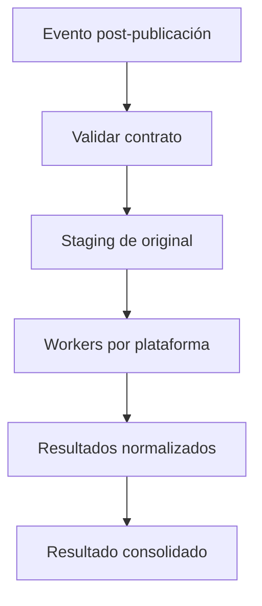

# OPMX Social Distribution Engine — Arquitectura v1.0

Estado: **IMPLEMENTACIÓN BASE — sin credenciales ni publicación real**
Actualizado: 2026-10-23

## Objetivo y límite

Social recibe únicamente una nota cuya publicación ya fue confirmada. No redacta, altera copy, decide target ni modifica el Publisher. Su función es preparar una copia técnica del asset, publicar por plataforma y registrar el resultado aislado de cada rama.

## Componentes versionados

| Componente | Archivo | Responsabilidad |
|---|---|---|
| Coordinador | `workflows/social/OPMX_SOCIAL_DISTRIBUTION_ENGINE_v1.0.json` | Validar, derivar claves de idempotencia, preparar staging y despachar ramas aisladas. La consolidación durable se habilita al aprobar el almacén de resultados. |
| Media staging | `workflows/social/OPMX_SOCIAL_MEDIA_STAGING_v1.0.json` | Copiar el original sin alterarlo a un objeto público, inmutable y de dominio verificado. |
| Threads worker | `workflows/social/OPMX_SOCIAL_THREADS_v1.0.json` | Publicar una imagen de Threads en el flujo oficial contenedor → publicación. |

Cada workflow se importa de forma independiente. El coordinador se conecta a los workers sólo después de importar, guardar sus IDs y configurar las referencias `Execute Workflow` en n8n; esos IDs son de entorno y nunca se versionan.

## Contrato de frontera

`contracts/SOCIAL_DISTRIBUTION_CONTRACT_v1.0.json` es el contrato activo de entrada/salida. La integración futura desde Publisher será un adaptador que construya este evento **después** de leer la publicación válida de WordPress. No se modifica Publisher para acomodar Social.

El contrato exige `event_id`, `publisher_run_id`, `source_post_id`, URL pública final, texto aprobado, URL del original, SHA-256, derechos aprobados, targets explícitos e `idempotency_key`. El resultado entrega exactamente un registro por cada una de las nueve plataformas.

## Flujo definitivo

Patrón fijo de cada worker:

`SHOULD_PUBLISH → IDEMPOTENCY_CHECK → PRECHECK → PUBLISH → VERIFY → SUCCESS | FAILED | SKIPPED`

Una rama nunca cancela otra. `SKIPPED` se utiliza solamente cuando el target está deshabilitado o su política exige operación manual; una plataforma habilitada que carezca de credencial o precheck se reporta `FAILED`.

## Propuesta de media staging pendiente de aprobación de infraestructura

La implementación recomendada es **Cloudflare R2 con custom domain público y estable**, preferentemente `media.opmx.com.mx` (o el dominio que se apruebe y después se verifique en TikTok). La escritura se haría desde n8n con una credencial S3-compatible guardada en n8n; la lectura sería pública por HTTPS. No se ha creado infraestructura ni aprobado el dominio en este hito.

- Ruta inmutable: `social/v1/{source_site}/{source_post_id}/{sha256}/original.{ext}`.
- El original se copia byte por byte; no se sobrescribe ni se recorta.
- Variantes se guardan en `derived/{variant}/{sha256}.{ext}` y conservan `parent_sha256`.
- Cache-Control: `public, max-age=31536000, immutable`.
- Retención mínima: 30 días antes de cualquier limpieza; no se usan URLs firmadas ni temporales.
- El precheck realiza `HEAD` público, comprueba 2xx, `Content-Type`, longitud y SHA-256 antes de que cualquier API recupere el archivo.

Esto satisface la recuperación pública requerida por Threads, Instagram y TikTok. La verificación de dominio/prefijo de TikTok y el DNS del custom domain son bloqueos de habilitación, no se simulan.

## Threads v1

La rama Threads publica una imagen sin modificar con el copy aprobado `SUBTITULO + "\\n\\n" + URL_OPURO`:

1. `POST https://graph.threads.net/v{version}/{threads-user-id}/threads` con `media_type=IMAGE`, `image_url`, `text` y `alt_text`.
2. Conserva el `creation_id` retornado.
3. `POST .../{threads-user-id}/threads_publish` con `creation_id`.
4. Lee el objeto publicado y guarda ID/permalink para verificación.

Autenticación: OAuth 2.0 de Threads con `threads_content_publish`; la configuración y renovación del token viven exclusivamente en la credencial n8n `OPMX Threads API`. No se reutiliza el token de Facebook o Instagram por similitud de proveedor.

## Idempotencia y reintentos

- Clave por resultado: `sha256(event_id + ":" + platform + ":" + social_contract_version)`.
- El registro persistente será una tabla/colección `social_distribution_runs` con índice único `(platform, idempotency_key)`; no se usa memoria de ejecución de n8n como evidencia de deduplicación.
- Antes de llamar a la API se consulta ese registro. Un `SUCCESS` previo devuelve `SKIPPED/DUPLICATE`; una ejecución en curso se bloquea temporalmente.
- Reintentos automáticos: máximo 3 para 408, 429 y 5xx, con backoff exponencial y jitter. No reintentar 4xx de validación, permisos, media ni políticas.
- Si una llamada puede haber publicado y la respuesta se perdió, el worker debe verificar por `provider_request_id`/ID conocido antes de reintentar. No repetir a ciegas un POST de publicación.

## Bloqueo de almacenamiento durable

La arquitectura necesita una decisión aprobada sobre el almacén de `social_distribution_runs` y alertas. **No se eligió ni se creó uno en este hito**, porque no existe una fuente de verdad de infraestructura para Postgres/Neon, D1, Redis u otro servicio en `main`. El JSON del coordinador es importable como esqueleto de routing, pero no debe activarse en producción hasta que se configure ese store, se conecten los IDs de los subworkflows importados y se añada el consolidado sobre registros persistidos.

## Observabilidad

Cada evento usa `correlation_id` y emite un resultado por plataforma con: estado, clave idempotente, intentos, marcas de tiempo, request ID del proveedor, ID/permalink del post, URL del asset y error normalizado sin token. n8n debe conservar los execution logs y enviar los fallos a un canal de alerta que se definirá fuera de este repositorio.

## Seguridad

Las credenciales, IDs de cuenta, URLs internas, tokens y secret keys viven en n8n/gestor de secretos. El repositorio sólo contiene nombres lógicos de credenciales, contratos y workflows importables.
