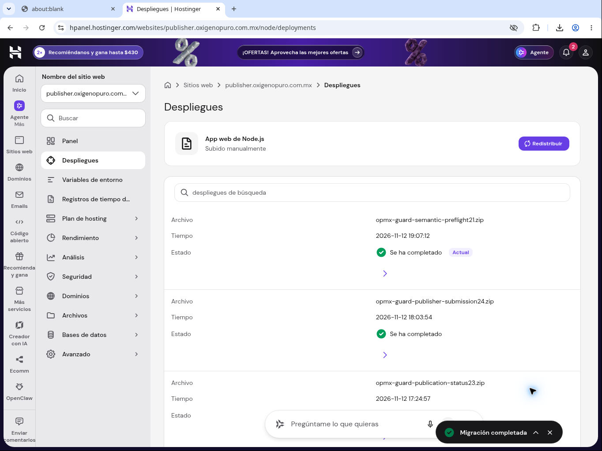

# Issue #21 — preflight semántico desplegado y comprobado

Corte final: 13 de noviembre de 2026 UTC / 12 de noviembre, CDMX. **La corrección está activa.** Este corte sustituye el estado de despliegue pendiente conservado más abajo.

El preflight ejecuta la preparación y normalización estáticas de los destinos seleccionados antes de aceptar el envío a Publisher. Los campos inválidos conocidos devuelven `VALIDATION_FAILED`, diagnóstico acotado y `writesStarted:false`. El documento original y el perfil LITERAL se conservan. Los resultados inciertos después de aceptar mantienen su conciliación; no autorizan reenvío.

## Despliegue y fuentes

| Componente | Evidencia |
| --- | --- |
| Fuente de implementación | `4b9116419a2d5a6b7ff12152f7a26b762a58219a` |
| Manifiesto candidato que ahora corresponde a producción | `edb20e76ad20b033cc68b80af98100dde33eb9a6` |
| Hostinger | `opmx-guard-semantic-preflight21.zip`, completado y Actual a las **19:07:12 CDMX del 12nov** |
| Archivo desplegado | **195143 bytes**, SHA-256 `f31660357f16ff087284e8929549a427cc5f85fb8ff2eba79a612d24c18d2220` |
| MCP activo | `1b78dc88-cb9b-456f-b711-c3328031e61d`, **152 nodos y 5 grupos** |
| Huella del grafo activo | `1b1de2dea56ac4c738c9bf2c8ad26af6f082f520fd4cc64f361da2596b6ed56b` |
| Borrador ajeno preservado | `a342823c-1a68-4dfc-81ab-622daf2061cd`, **112 nodos**, contenido idéntico |
| Probe restaurado | `5202de12-b06e-4d19-8137-00794fe9b799`, inactivo, 3 nodos, sin retención, timeout 30s |

La desconexión anterior borró scratch. Se recuperó por el administrador de archivos la carpeta fuente `hbuilds/last-source` que correspondía al release24 activo. Contenía 83 archivos y ningún .env ni node_modules. Se conservaron íntegros bootstrap, package.json, dependencia mysql2 fijada y todos los módulos. Comparación byte a byte de los 83 archivos: cambia exclusivamente `writer-release-manifest.mjs`. El ZIP reconstruido tiene una huella distinta del ZIP temporal anterior por sus metadatos; la huella válida del archivo realmente desplegado es la de la tabla. El [ZIP completo](opmx-guard-semantic-preflight21.zip) queda versionado para no depender de scratch.

Se publicó por su ID la candidata histórica comprobada, sin activar ni sobrescribir el borrador112. La lectura posterior confirmó ambos grafos y la huella real del activo mediante `writerGraphFingerprint`. El manifiesto en la punta de la rama vuelve a reflejar este pin activo. Shared, Form, Update, Reader, monitor y el único Motor/suscripción READY/preview no fueron modificados.

## Comprobaciones

- **48 pruebas específicas y 741 conjuntas: PASS** en la fuente ya fijada; no cambió esa lógica durante el reintento.
- **n8n38026: 27 casos y 157 aserciones PASS**, ejecutando las fuentes Code reales sobre datos sintéticos, sin I/O externo.
- El ZIP reconstruido volvió a pasar arranque síncrono CommonJS y escucha del servidor, HTTP401 sin credencial y **14 rutas que deniegan con HTTP503** cuando MySQL simulado falla. Cero conexiones reales, CMS o Telegram.
- **n8n38041: HTTP200 / RUNTIME_OBSERVED**, `versionsMatch:true` y `noActiveN8nWriters:true`. Guard reconoció las cinco versiones esperadas, incluido MCP152; los cuatro escritores restantes conservaron sus versiones. `authorizesRecovery:false` y `motorTerminationVerified:false`.
- Probe restaurado a sus nodos, conexiones, credenciales y settings originales y releído. No queda webhook o programación nueva.

La comprobación cubre lógica del preflight, ensamblaje y compatibilidad productiva de Guard/n8n. No creó, publicó ni editó notas, no reclamó intentos, no reabrió paquetes y no envió mensajes. La validación estática declara que las comprobaciones dinámicas de permisos/disponibilidad CMS no se ejecutan en esa etapa.

[Datos de comprobación](EVIDENCIA_FINAL.json) · [Release](release.json).

## Reversión conjunta

Restaurar el MCP activo anterior `1b3bb5c6-e871-4d43-a9c1-21f7ef11cacb` y el Guard24 compatible `opmx-guard-publisher-submission24.zip`, SHA-256 `ee200f0986c682f109737b24192e961af54e9b51fd26f65fdcb1fec45aba3c96`. Conservar el draft112 y todos los recibos/estados históricos. El draft112 no es una versión de reversión productiva. Esta reversión no exige tocar Motor, suscripción, notas o credenciales.

## Historial anterior de preparación y desconexión

El contenido siguiente describe el estado anterior al despliegue confirmado de arriba.

# Issue 21: evidencia de validación estática

Fecha: 13 de noviembre de 2026. Alcance: detectar rechazos semánticos conocidos antes de aceptar Publisher, sin publicar ni repetir paquetes pendientes.

## Fuente y QA aislado

- 48 pruebas específicas del preflight: PASS.
- 741 pruebas conjuntas de editorial, Guard y Receiver: PASS.
- Ejecución n8n `38026`: `SEMANTIC_PREFLIGHT_QA_PASSED`, 27 casos y 157 aserciones. El integrador confirmó la restauración del probe inactivo después de la prueba.
- Resultado del probe: `externalIoCalls:0`, `cmsWrites:0`, `telegramMessages:0`, `guardMutations:0`, `scope:STATIC_CODE_ONLY`.

El probe ejecutó las fuentes candidatas reales del Code y del formatter con datos sintéticos. Cubrió los siete conjuntos de destinos, campos obligatorios, categorías, jerarquía, estado, autor prohibido, slug, archivos, bloques y placeholders; además, validación sin identificador externo, rechazo de escritura sin identificador, OPOL sin Hero y conservación del contenido LITERAL. No es una prueba de publicación en WordPress.

El grupo visual añadido después del probe no cambió ninguna fuente ejecutada: el Code de QA generado es idéntico byte por byte al de `38026`. La regresión de fuente se repitió después de agregar el grupo y conservó los 741 PASS.

## Fuentes exactas y grafo

Base publicada MCP: `bnzVMNkZuGO1GQCZ`, versión `1b3bb5c6-e871-4d43-a9c1-21f7ef11cacb`, 151 nodos. La candidata añade un Code y conserva los controles existentes: 152 nodos previstos.

Shared sin cambios: `4o7K5TmKc7joScqB`, versión `4263fea4-90a4-406d-a234-da7397d456bf`, 146 nodos.

| Fuente Shared incrustada | SHA-256 |
| --- | --- |
| Preparar MASTER y binarios | `8db8e0c0aaafd824450551a91b174c073a02d2da4c7c8c5c4069a22766add645` |
| Validar y normalizar OPMX MASTER | `710a625882e6ffcdf05a4ff694d1475b07b60a068006702a76ff7ace84bb6b5c` |

Las 11 operaciones candidatas agregan el grupo `Validación MASTER antes de aceptar` con ID `00e1fe38-96aa-4a71-94c0-da882b61421d`, cuyo único miembro es `MASTER — Validación estática Shared`. Se conserva la identidad y membresía de los cuatro grupos previos. El único miembro concentra todas las entradas y salidas externas del grupo; no se incluye ningún trigger ni se solapan miembros.

## Integración comprobada; despliegue pendiente por entorno no disponible

Fuente21:4b9116419a2d5a6b7ff12152f7a26b762a58219a. Preparación n8n:11operaciones aplicadas,152nodos, cinco grupos; sólo advertencia de lienzo preexistente. Grafo cotejado exactamente contra builder, IDs originales y conexiones esperadas: huella1b1de2dea56ac4c738c9bf2c8ad26af6f082f520fd4cc64f361da2596b6ed56b. Versión candidata guardada en historia:1b78dc88-cb9b-456f-b711-c3328031e61d. NO PUBLICADA.

Se ensambló un Guard basado íntegramente en issue24, conservando sus13deltas runtime anteriores y cambiando únicamente writer-release-manifest.mjs al pin candidato. Arranque y14rutas de denegación sin estado auténtico:PASS. Archivo preparado opmx-guard-semantic-preflight21.zip,195143bytes,SHA256c023a111a8448df8b0cf96c4fcfc5eb8fe26a2cd9d2d5468ecb8ab25dd45a3ec. Fuente/manifiesto candidato inmutable:edb20e76ad20b033cc68b80af98100dde33eb9a6. El ZIP local puede requerir reconstrucción si se pierde el entorno; el commit preserva las fuentes.

El panel Hostinger se observó antes de subir: seguía Actual/completado opmx-guard-publisher-submission24.zip. La llamada de preparación de documentación del navegador agotó300s y el entorno pasó a unavailable; desapareció la capacidad de navegador. No se llegó a pulsar Redistribuir ni a subir el ZIP. No se modificó Hostinger y NO se publicó el MCP candidato. No hay bloqueo de aprobación ni una decisión pendiente del usuario.

Por seguridad operativa se restauró el draft ajeno112nodos desde719ed751-2e44-418f-bbe9-90e9965084d1; nuevo draft a342823c-1a68-4dfc-81ab-622daf2061cd. Relectura: nodos/conexiones idénticos al snapshot original, activo todavía1b3bb5c6-e871-4d43-a9c1-21f7ef11cacb/151nodos. El manifiesto de la punta de rama se devuelve al pin productivo anterior; el commit candidato anterior queda disponible. Shared y los otros escritores no cambiaron.

## Continuación necesaria

1. Recuperar un entorno con acceso al panel Hostinger y las fuentes fijadas; releer este índice, versiones activas y drafts por concurrencia.
2. Reconstruir/preparar el release candidato desde la base24 y su único delta de manifest; volver a cotejar huella/pins y comprobar escritores inactivos. No activar el draft112.
3. Desplegar Guard compatible y publicar exactamente la versión candidata152 de forma coordinada, o regenerarla desde activo si la historia expiró. Conservar/restaurar el draft ajeno.
4. Comprobar estado Hostinger y observar versiones/huellas reales desde Guard. Sólo entonces cerrar21. No reenviar paquetes ni publicar notas como prueba.

## Límites y reversión

VALIDATION_FAILED lleva campos acotados,writesStarted:false,retryPermitted:false. Errores locales desconocidos siguen FILES_REJECTED; resultados posteriores a aceptar siguen sujetos a conciliación24. La validación estática no promete disponibilidad/permisos actualesCMS. No se alteró el único Motor ni preview por esta candidata. Como21no se activó, no requiere reversión productiva; el draft112ya está restaurado y Guard/MCP actuales siguen compatibles.
